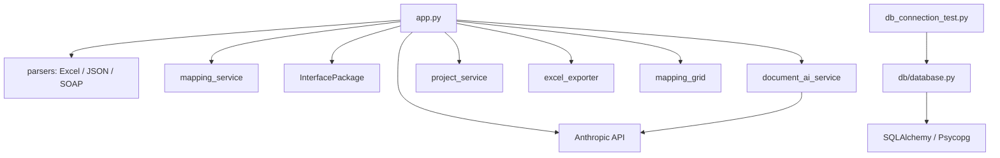

# Interface Mapping Assistant 3.0 — Project Structure and Dependency Review

Review date: 2026-10-25

Review type: Read-only source and architecture review

## Scope and Evidence

This report preserves the findings and recommendations from the project structure and code dependency review. It documents the transition from an AI Mapping Assistant to an Interface Mapping Registry & Management Platform.

The intended capabilities are:

- Customer and Interface Registry.
- Customer → CJ EDI → OMS → WMS Mapping Management.
- Excel Import and Export.
- Mapping CRUD and Search.
- Revision, Approval, and Audit.
- Later integration of AI Mapping results as Drafts that require human review before publication.

Evidence consists of local directory listings, Python source inspection, dependency searches, the dependency manifest, and the project state document. No application, Python test, Git operation, database command, API request, or migration was executed during the review. Secret configuration files, credentials, saved project data, uploaded customer documents, and database contents were not inspected.

**Observed** means directly supported by the inspected source or directory listing. **Recommended** means a proposed future change, not an implemented capability. Static references do not prove runtime correctness. The connection verification results in the project state document were supplied by the user previously; they were not reproduced during this review.

No refactoring was performed. The 3.0 project must remain independent of the 2.0 project.

## A. Current Project Structure

### Observed: Directory and Module Inventory

The main structure is shown below. Environment directories, repository internals, secret configuration, and data contents are omitted.

```text
Interface-Mapping-Assistant-3.0/
├── app.py
├── parsers/
│   ├── __init__.py
│   ├── excel_parser.py
│   ├── json_parser.py
│   └── soap_parser.py
├── mapping/
│   ├── __init__.py
│   └── mapping_service.py
├── models/
│   ├── __init__.py
│   └── interface_package.py
├── services/
│   ├── __init__.py
│   ├── document_ai_service.py
│   └── project_service.py
├── exporters/
│   ├── __init__.py
│   └── excel_exporter.py
├── ui/
│   ├── __init__.py
│   └── mapping_grid.py
├── db/
│   └── database.py
├── docs/
│   └── PROJECT_STATE.md
├── projects/                  # Contents were not inspected.
├── aggrid_test.py
├── excel_parser_test.py
├── excel_preview_test.py
├── soap_parser_test.py
├── test_claude.py
├── db_connection_test.py
├── target_complex.json       # Contents were not inspected.
├── requirements.txt
└── AGENTS.md
```

The six listed package `__init__.py` files are empty. The structure above represents the application reviewed before this report was added; it does not imply that the proposed architecture already exists.

| Module | Observed responsibility |
|---|---|
| `app.py` | Streamlit page construction, workspace state, file analysis orchestration, AI mapping, mapping rules, project operations, and export orchestration. |
| `parsers/excel_parser.py` | Excel workbook reading, sheet classification, header recognition, field extraction, path reconstruction, evidence metadata, and optional AI assistance. |
| `parsers/json_parser.py` | Flattening nested JSON objects and arrays into a shared field representation. |
| `parsers/soap_parser.py` | XML, SOAP, WSDL, and XSD structure traversal, namespace and attribute extraction, and AI payload construction. |
| `mapping/mapping_service.py` | Associating AI results with actual fields and building source/target mapping rows, including unmatched fields. |
| `models/interface_package.py` | A standard-library dataclass holding one structure file, reference files, and a source/target role. |
| `services/document_ai_service.py` | Calling Claude to extract interface information and fields from document payloads, using Pydantic structured output. |
| `services/project_service.py` | Building workspace snapshots and saving, loading, listing, renaming, and deleting local JSON projects. |
| `exporters/excel_exporter.py` | Generating English and Korean Interface Mapping Specification workbooks as bytes. |
| `ui/mapping_grid.py` | AG Grid rendering, editing, filtering, hierarchy compatibility, and returning a complete edited dataset. |
| `db/database.py` | Shared SQLAlchemy Engine and SessionLocal configuration. |
| Root diagnostic and preview scripts | Manual component checks, UI previews, API connectivity diagnostics, and database connectivity verification. |

### Observed: Application Entry Structure

`app.py` is approximately 5,800 lines long. It is a top-level Streamlit script, without a separate `main()` function or an existing multipage navigation structure.

It directly imports the production modules listed above except `db/database.py`. It also directly imports Streamlit, pandas, Pydantic, and the Anthropic SDK.

The main execution flow is:

1. Load application configuration and define Pydantic AI output models, field processing functions, and page constants.
2. Configure the page. The displayed title still identifies the application as Interface Mapping Assistant 2.0.
3. Initialize workspace state and handle project creation, loading, saving, renaming, deletion, and unsaved-change guards.
4. Accept Source and Target structure files and reference documents.
5. On an explicit AI generation action, parse the packages, enrich fields, and call Claude.
6. Assemble mapping rows, hierarchy values, reference conflicts, and review reasons.
7. Allow editing of interface information, transmission information, mappings, and return values.
8. Save a local JSON project or generate English and Korean Excel workbooks.

AI calls are not confined to `document_ai_service.py`. Interpretation of unresolved Excel content, batched field mapping, and return-value analysis also remain in `app.py`. Main field mapping uses batches of 15 source fields and includes retry handling.

Workspace operations are deliberately coordinated with editor synchronization. Some actions are queued and processed after edited values have been copied back into session state.

## B. Module Dependency Analysis

### Observed: Direct Dependency Graph

Arrows indicate imports or calls in the inspected source.



### Observed: Import Boundaries

No direct circular imports were found among the inspected production modules. Most coupling is concentrated in `app.py`.

| Component | Direct dependencies and boundary |
|---|---|
| Excel parser | Standard library and openpyxl; accepts an optional AI callback without importing the AI service, UI, or database. |
| JSON parser | Python data structures; no UI, AI SDK, or database dependency. |
| SOAP parser | Standard-library XML and byte utilities; no UI or database dependency. |
| Mapping row builder | Lists and dictionaries; no Streamlit, AI SDK, or database dependency. |
| InterfacePackage | Standard-library dataclass and typing utilities. |
| Document AI service | Anthropic SDK, Pydantic, configuration loading, and JSON utilities; no database dependency. |
| Project service | pandas, JSON, UUID, datetime, and filesystem utilities; no database dependency. |
| Excel exporter | openpyxl and byte utilities; accepts DataFrame-like inputs and returns workbook bytes without directly importing Streamlit. |
| Mapping grid | Streamlit, pandas, AG Grid, JavaScript configuration, and hierarchy helpers. |
| Database module | SQLAlchemy, Psycopg through the connection driver, and configuration loading. |

These existing boundaries support incremental extraction. The principal issue is that `app.py` combines presentation, data conversion, rules, workspace control, and AI orchestration.

### Observed: Primary Functional Calls

| Stage | Main calls or operations |
|---|---|
| Package construction | Create source and target `InterfacePackage` instances. |
| Package analysis | `analyze_interface_package()` coordinates structure and reference analysis. |
| JSON analysis | `read_json_file()` → `flatten_json()` → `normalize_standard_fields()`. |
| XML analysis | `read_soap_xml_file()` → `build_soap_ai_payload()` → `analyze_document_payload()` → field normalization. |
| Excel analysis | `analyze_excel_reference()` → `parse_excel_reference()` with an AI callback for unresolved blocks. |
| Evidence enrichment | `merge_reference_fields()` and `enrich_structure_fields()` fill missing metadata and retain conflicts. |
| AI mapping | Batched Claude calls using `MappingAnalysisResult`, followed by separate return-value analysis. |
| Mapping assembly | Source/target enrichment → `build_mapping_rows()` → hierarchy → conflict and review-reason rules. |
| Editing | Streamlit data editors and `render_mapping_grid()`, followed by session-state updates. |
| Project persistence | Snapshot construction and project service save/load/list/rename/delete functions. |
| Excel export | `build_export_mapping_df()` → `create_interface_mapping_excel()` → download controls. |

### Observed: Three Data Representations

| Representation | Current use | Recommended future handling |
|---|---|---|
| Dictionaries using `Path`, `Field`, `Type`, and related keys | Shared parser output and field normalization. | Preserve compatibility while introducing an explicit field contract. |
| Rows using `source_field`, `target_field`, `mapping_status`, and related keys | Mapping assembly and AG Grid editing. | Treat as editing/view data rather than database entities. |
| DataFrames with bilingual Korean/English column names | Interface information, transmission information, and formal Excel output. | Separate display/export labels from database field names. |

`build_export_mapping_df()` in `app.py` adapts internal mapping keys to bilingual export keys. This is a useful boundary to preserve and later extract.

### Observed: Database and Registry Readiness

The shared Engine and SessionLocal exist. In the inspected source, only `db_connection_test.py` imports them. The main application does not yet use database persistence.

No implementation was found for:

- SQLAlchemy ORM entities, a declarative Base, table relationships, or table creation definitions.
- An initialized Alembic migration directory.
- Database-backed Customer or Interface Registry services.
- Database-backed Mapping CRUD or cross-customer, cross-version Search.
- Revision, Approval, or Audit workflows.

Local JSON project CRUD is not equivalent to Registry database CRUD. AG Grid filtering is not equivalent to Registry-wide Search.

The project state document records user-confirmed Engine and SessionLocal read-only connection verification. This proves neither business model implementation nor Registry integration. No database inspection was performed, so the review does not establish which tables may exist in the database independently of the source.

### Observed: Existing Models and Persistence Semantics

- `InterfacePackage` is a dataclass, not a Pydantic model or ORM entity. Its file attributes use `Any` and may hold uploaded file objects.
- `MappingItemAI`, `ReturnValueAI`, `MappingAnalysisResult`, and Excel AI output models in `app.py` use Pydantic.
- `DocumentFieldAI` and `DocumentAnalysisAI` in the document AI service also use Pydantic.
- Mapping rows are dictionaries, and working views are predominantly DataFrames.
- Project metadata includes an immutable project identifier and a display name. Project naming is deliberately independent of interface naming.
- Project snapshots include interface information, both transmission sections, mapping rows, return values, and reference conflict review state.
- Uploaded file binaries are explicitly excluded from the current project snapshot.
- `schema_version: 1` identifies the snapshot format, not a business revision.
- Saving an existing project overwrites its current snapshot. This is not an immutable revision history.
- Revision-history sheet classification in the Excel parser is document recognition, not a Revision database entity.

### Observed: Capabilities to Preserve for Future AI Mapping

| Capability | Current location | Reuse value |
|---|---|---|
| Nested JSON flattening | `parsers/json_parser.py` | Preserves field paths and samples for nested objects and arrays. |
| XML structure and namespace extraction | `parsers/soap_parser.py` | Preserves SOAP/WSDL/XSD structural context for later interpretation. |
| Deterministic Excel extraction | `parsers/excel_parser.py` | Header aliases, sheet classification, path reconstruction, source file/sheet/row evidence, and parsing warnings. |
| Optional AI assistance callback | `parse_excel_reference(..., ai_assist=...)` | Supports offline deterministic parsing followed by selective AI interpretation. |
| Structured document extraction | `services/document_ai_service.py` | Claude prompts, Pydantic responses, and conversion to shared field data. |
| Path-first result association | `mapping/mapping_service.py` | Associates AI-selected fields with actual source/target fields and retains unmatched rows. |
| Structure/reference merge rules | `app.py` | Structure remains authoritative; references fill gaps and produce explicit conflicts. |
| Review rules | `app.py` | Low confidence, type transformation, format conversion, and reference-conflict indicators. |
| AI output models | `app.py` and the document AI service | Preserve structured response contracts. |
| Batched mapping, retry handling, and return analysis | `app.py` | Preserve the existing AI orchestration behavior. |

Important capability limits:

- `mapping_service.py` primarily associates results and assembles rows. No independent semantic similarity algorithm was found there.
- Excel header matching uses normalized aliases and conservative containment matching.
- `rapidfuzz` is declared in `requirements.txt`, but no Python source use was found.
- `pyyaml` is also declared without an identified source use. No implemented OpenAPI YAML parser was found.
- The SOAP parser traverses document structure; it should not be described as a complete WSDL/XSD semantic interpretation engine.
- The upload interface accepts multiple reference formats, but the current analysis path processes `.xlsx` and `.xlsm`. PDF, Word, and image analysis remain unconnected; legacy `.xls` is rejected safely by the Excel parser.
- The JSON parser uses the first object in an array as the structural sample. Its output is not necessarily an exhaustive schema for heterogeneous arrays.

## C. Recommended Target Architecture

### Recommended: Architecture Direction

Retain a single application using Streamlit and PostgreSQL. Establish Registry business boundaries first, and migrate existing functionality incrementally instead of rewriting the application in one operation.

Registry operations should work without AI configuration or an AI service connection. AI SDK initialization and model configuration should enter the execution path only when an AI feature is used.

AI output should become a candidate Draft through the same validation and review boundary used by manual or Excel input. It must not directly publish Registry records.

### Recommended: Target Directory Structure

The following is a future proposal. These files and directories have not been created as part of the review.

```text
app.py                         # Application entry and navigation.

ui/
    pages/
        customer_registry.py
        interface_registry.py
        mapping_management.py
        revision_review.py
        import_export.py
        ai_workspace.py
    mapping_grid.py
    workspace_state.py

domain/
    enums.py                   # Mapping quality and revision lifecycle states.
    validation.py              # Business constraints.

schemas/
    registry.py                # Registry input/output contracts.
    mapping.py                 # Mapping and Draft data contracts.
    ai.py                      # Pydantic AI output models.

models/
    interface_package.py       # Preserve the current upload container initially.

services/
    registry_service.py
    mapping_service.py
    revision_service.py
    import_service.py
    export_service.py
    draft_import_service.py
    project_service.py         # Existing JSON workspace compatibility.

repositories/
    customer_repository.py
    interface_repository.py
    mapping_repository.py
    revision_repository.py

db/
    database.py
    base.py
    models/
        customer.py
        interface.py
        mapping.py
        revision.py
        approval.py
        audit.py

parsers/                       # Preserve existing parsers.
exporters/                     # Preserve Excel output capability.

ai/
    document_service.py
    mapping_service.py
    mapping_rules.py
    client.py

adapters/
    field_adapter.py
    dataframe_adapter.py
    legacy_project_adapter.py

alembic/
tests/
    unit/
    integration/
    fixtures/                  # Synthetic data only.
tools/
    previews/
    diagnostics/
docs/
```

This is a logical target, not a requirement to create every file immediately. Introduce each boundary only as the corresponding capability is implemented and validated.

### Recommended: Dependency Direction

```text
UI → Services → Repositories → PostgreSQL
         ↓
   Domain / Schemas

Excel / AI / Legacy JSON
         ↓
      Adapters
         ↓
   Draft Import Service
         ↓
 Registry Draft → Human Review → Publication
```

Business services should own validation and transaction boundaries. Repositories should handle persistence, and UI components should not issue database writes directly. ORM entities, AI response models, uploaded-file containers, and DataFrame views should remain distinct representations with explicit conversions.

### Recommended: Business Boundaries to Finalize Before ORM Implementation

| Concept | Proposed responsibility |
|---|---|
| Customer | Customer ownership and business identifiers. |
| Interface | Interface registration, system endpoints, direction, and field definitions. |
| Mapping | Relationships between fields at two endpoints and transformation rules. |
| Revision | A particular version of interface or mapping content. |
| Approval | Review decision, actor, time, and comments. |
| Audit | Traceable business operations. |
| AI Draft | Candidate results with provenance, confidence, and explanations. |

Represent Customer → CJ EDI → OMS → WMS as ordered system nodes and mapping segments, with support for optional nodes or alternate routes where required. The exact relationships require business confirmation. Existing Source/Target processing can be reused for individual segments.

Keep mapping quality separate from publication lifecycle:

- Mapping quality includes `Mapped`, `Source Only`, `Target Only`, and `Review Required`.
- Revision lifecycle may include Draft, pending review, Approved, and Published, subject to agreed workflow rules.

A `Mapped` result or a high AI confidence score must not be interpreted as approval.

The schema review should explicitly address immutable identifiers, uniqueness scope, interface and field versions, message direction, path identity, revision ownership, publication behavior, and audit actors. Uploaded file objects cannot be persisted directly as ordinary ORM values; file metadata and binary storage policy require separate decisions.

## D. File-by-File Recommendations

Each existing file below has a primary classification. `RETAIN FOR AI` does not mean the file is currently unused: those modules remain part of the active application. A future destination is a proposal, not a completed move.

### KEEP — Preserve the Current Location

| File | Classification | Observed references | Recommendation, reason, and potential impact |
|---|---|---|---|
| `db/database.py` | KEEP | Imported by `db_connection_test.py`; not imported by the main app. | Preserve the shared connection entry. Add ORM Base and entity modules alongside it later, without turning the upload dataclass into an ORM entity. |
| `parsers/excel_parser.py` | KEEP | Imported by `app.py` and `excel_parser_test.py`. | Reuse for Registry import and AI preparation. Preserve deterministic extraction and the optional AI callback. It is not yet a complete Registry import workflow. |
| `exporters/excel_exporter.py` | KEEP | Imported by `app.py` and `excel_preview_test.py`. | Preserve the existing formal workbook template and byte output. Connect Registry data through an adapter rather than changing the template contract immediately. |
| `ui/mapping_grid.py` | KEEP | Imported by `app.py` and `aggrid_test.py`. | Reuse editing and filtering. Later add persistent row identity and revision-dependent editability. Keep database writes outside the component. |
| `parsers/__init__.py` | KEEP | Package initializer for parser imports; currently empty. | Preserve package structure. Empty content is not a reason for removal. |
| `mapping/__init__.py` | KEEP | Package initializer for mapping imports; currently empty. | Preserve existing import compatibility until any planned relocation is complete. |
| `models/__init__.py` | KEEP | Package initializer for model imports; currently empty. | Preserve the current container import path. |
| `services/__init__.py` | KEEP | Package initializer for service imports; currently empty. | Preserve package structure as service boundaries evolve. |
| `exporters/__init__.py` | KEEP | Package initializer for exporter imports; currently empty. | Preserve package structure. |
| `ui/__init__.py` | KEEP | Package initializer for UI imports; currently empty. | Preserve package structure. |
| `requirements.txt` | KEEP | Dependency manifest for environment setup. | Preserve the manifest. Review version constraints and unused declarations in a separate task. |
| `AGENTS.md` | KEEP | Development and safety instructions. | Preserve workflow, approval, testing, and project independence requirements. |
| `docs/PROJECT_STATE.md` | KEEP | Project handover and recorded verification status. | Preserve historical evidence. Distinguish user-provided verification from any future agent-run checks. |

### REORGANIZE — Extract or Relocate Incrementally

| File | Classification | Observed references | Recommendation, reason, and potential impact |
|---|---|---|---|
| `app.py` | REORGANIZE | Main Streamlit entry; directly imports the production components. | Preserve the entry while extracting pages, pure rules, adapters, and AI orchestration. Changes to session-state keys, execution order, editor synchronization, and unsaved-change guards carry regression risk. |
| `services/project_service.py` | REORGANIZE | Imported by `app.py` for local project operations. | Preserve legacy JSON compatibility. Later separate filesystem persistence from snapshot conversion. Do not silently replace its behavior with database operations under the same API. |
| `db_connection_test.py` | REORGANIZE | Standalone manual verification script; no application import found. | Preserve the existing command initially. Later place it in diagnostics or explicitly enabled integration tests so ordinary unit-test loading does not connect to a database. |
| `aggrid_test.py` | REORGANIZE | Standalone Streamlit preview importing mapping row construction and the grid. | Move to `tools/previews/` only in an approved task. It provides manual UI verification, not assertion-based automated coverage. |
| `soap_parser_test.py` | REORGANIZE | Standalone Streamlit preview importing the SOAP parser and payload builder. | Preserve its inspection value; later place it under preview tools and add separate synthetic XML unit tests. |
| `excel_preview_test.py` | REORGANIZE | Standalone preview importing the Excel exporter. | Preserve template regression value. Later move to preview tools, after confirming embedded sample content is appropriate for reuse. No embedded values are reproduced in this report. |

### RETAIN FOR AI — Preserve Future AI Mapping Capability

| File or source block | Classification | Observed references | Recommendation, reason, and potential impact |
|---|---|---|---|
| `parsers/json_parser.py` | RETAIN FOR AI | Imported by `app.py`. | Preserve nested path extraction. Account for first-object array sampling before treating output as a complete field specification. |
| `parsers/soap_parser.py` | RETAIN FOR AI | Imported by `app.py` and `soap_parser_test.py`. | Preserve namespaces, attributes, hierarchy, and AI payloads. Add deeper deterministic schema interpretation only when separately scoped. |
| `mapping/mapping_service.py` | RETAIN FOR AI | Imported by `app.py` and `aggrid_test.py`. | Preserve path-first matching and unmatched-row construction. A future move to `ai/mapping_rules.py` should maintain compatibility during migration. |
| `services/document_ai_service.py` | RETAIN FOR AI | Imported by `app.py`. | Preserve prompts, structured field extraction, and shared-format conversion. Later consolidate under `ai/` and centralize AI client configuration. |
| `models/interface_package.py` | RETAIN FOR AI | Imported by `app.py` to construct both package roles. | Preserve the upload-context container initially. Do not convert file-object attributes into database columns. |
| AI Pydantic models in `app.py` | RETAIN FOR AI within a REORGANIZE file | Used by Excel fallback, mapping, and return-value AI calls. | Extract to `schemas/ai.py` while preserving response contracts. |
| AI batching, retries, return-value analysis, enrichment, and review rules in `app.py` | RETAIN FOR AI within a REORGANIZE file | Used in the active generation pipeline. | Extract into AI orchestration, pure rules, and adapters. These are active features and must not be removed together with outdated page branding. |

### REVIEW FOR REMOVAL — Verify Before Any Removal

| File or candidate | Classification | Observed references | Recommendation, reason, and potential impact |
|---|---|---|---|
| `excel_parser_test.py` | REVIEW FOR REMOVAL | No application reference found; imports the Excel parser. | Uses a fixed personal-machine file path and print output without assertions. Replace its useful checks with synthetic fixtures before deciding whether it can be removed. The referenced workbook was not opened. |
| `test_claude.py` | REVIEW FOR REMOVAL | No application reference found. | Executes an API connectivity check at top level and contains non-English comments. Decide whether a dedicated diagnostic remains useful before removal. Do not include it in ordinary offline unit-test loading. |
| `build_excel_ai_payload()` in `parsers/excel_parser.py` | REVIEW FOR REMOVAL at function level; parent file is KEEP | Only the definition was found in the source search. | Marked as a backward-compatible public API. Check external/manual use before removal; repository import searches cannot establish that no external consumer exists. |
| `get_column_letter` import in `exporters/excel_exporter.py` | REVIEW FOR REMOVAL at import level; parent file is KEEP | Only the import was found in that file. | Small cleanup candidate for a separate approved task; not an architectural blocker. |
| `LIGHT_GRAY` in `exporters/excel_exporter.py` | REVIEW FOR REMOVAL at constant level; parent file is KEEP | Only the declaration was found in that file. | Small cleanup candidate; avoid combining it with behavioral refactoring. |
| `rapidfuzz` declaration in `requirements.txt` | REVIEW FOR REMOVAL at dependency level; parent file is KEEP | No Python call found. | May represent planned matching work. Confirm requirements and environment use before deleting it. |
| `pyyaml` declaration in `requirements.txt` | REVIEW FOR REMOVAL at dependency level; parent file is KEEP | No Python call found. | May represent planned OpenAPI support. No implemented YAML parser was found; confirm scope before deletion. |
| `target_complex.json` | REVIEW FOR REMOVAL | No matching Python source reference found. | Contents were not inspected. It may be a manually uploaded fixture; lack of a static reference does not prove it is obsolete. |

### Recommendation Boundaries

No production module is currently supported by sufficient evidence for deletion. Every main production module is still referenced by `app.py`, except the database connection module, which is referenced by its diagnostic script and remains required infrastructure.

The `projects/` directory is existing workspace storage, not a removal candidate. Its contents were not inspected. Repository internals, environment files, credentials, and other sensitive configuration are outside the cleanup scope.

## E. Refactoring Risks

The following risks are source-based assessments, not runtime failures reproduced during this review.

| Risk | Source evidence and potential impact | Recommended control |
|---|---|---|
| Page extraction changes execution order. | Some workspace actions are deferred until editor output is synchronized. Moving code can lose the most recent edit. | Preserve action ordering and verify editing followed immediately by Save, Load, New, and regeneration. |
| Filtering causes partial persistence. | The grid merges filtered edits into a full dataset using temporary `__row_id` values. | Preserve the full-data merge semantics and introduce persistent database row identifiers. |
| Quality flags are mistaken for approval. | Status and Review Reason are generated automatically; no approval actor, decision, or publication record is implemented. | Keep quality and lifecycle states separate and enforce review through services. |
| Manual edits leave stale quality indicators. | Review rules primarily run during AI generation, while the grid permits field editing. | Revalidate Draft content before saving or submitting for review. |
| Existing project compatibility is lost. | Snapshots contain multiple DataFrames and conflict review state, not only mapping rows. | Define a legacy adapter and verify full workspace round trips with synthetic data. |
| Snapshot format version is confused with business revision. | `schema_version: 1` is a format marker, and project saves overwrite the current snapshot. | Design Revision identity, immutability, and publication semantics explicitly. |
| Field identity is ambiguous. | Some matching logic falls back from paths to field names; repeated names can exist. | Scope identity by interface version, message direction, and field path, with explicit ambiguity handling. |
| Database constraints reject valid legacy working data. | Current structures permit blank strings, missing provenance, and textual type/size values. | Define conversion, validation, and error reporting before adding strict constraints. |
| Upload containers are treated as persistent entities. | `InterfacePackage` holds file objects using `Any`. | Separate upload context, file metadata, and persistent field definitions. |
| AI dependencies affect Registry availability. | The application directly imports Anthropic, and AI configuration loading is distributed. | Keep Registry execution independent and initialize AI components only when used. |
| Test collection triggers external actions. | Several root test scripts execute API requests, database connections, or local file reads at top level. | Separate previews, diagnostics, integration tests, and offline unit tests before broad test execution. |
| Excel import/export is assumed to be lossless. | The parser extracts field definitions; the exporter renders a formal presentation template. No Registry round-trip verification exists. | Define an import contract and verify complete data preservation separately from visual formatting. |
| Multi-system mapping loses segment relationships. | The current model is a two-sided source/target workspace. | Specify interface endpoints, field versions, segment order, and cross-segment traceability. |
| Dependency changes obscure refactoring results. | Only some dependencies have version constraints. | Record actual validated environment versions and avoid unrelated upgrades during extraction. |

Additional compatibility considerations:

- Preserve the existing distinction between immutable project identifiers and editable project names.
- Preserve field paths as technical identity; editable display hierarchy is not a substitute for the original path.
- Preserve reference evidence and review state through Draft import rather than assuming the exported workbook contains all AI provenance.
- The exporter deliberately omits AI-only confidence, reason, and status fields from the formal company template. Registry audit information therefore needs its own persistence path.
- Keep uploaded binaries outside the existing snapshot unless a separate storage policy is explicitly approved.
- Do not change or depend on the separate 2.0 project while restructuring the current 3.0 codebase.

## F. Suggested Small, Testable Refactoring Order

These are future candidate tasks, not work authorized or executed by the review. Complete one task at a time, explain the files affected, obtain approval, and use evidence-based validation before proceeding.

| Order | Small task | Future validation focus |
|---|---|---|
| 1 | Finalize Registry entities, relationships, and identifiers. | Walk through synthetic Customer → CJ EDI → OMS → WMS examples and confirm ownership of interfaces, fields, mappings, revisions, and approvals. |
| 2 | Separate automated test loading from manual diagnostics and previews. | Ordinary offline unit-test loading must not call APIs, connect to a database, or open personal file paths. |
| 3 | Extract pure field normalization and hierarchy functions. | Identical synthetic inputs produce identical field, path, and hierarchy output; legacy input shapes remain supported. |
| 4 | Extract AI Pydantic models and pure mapping/review rules. | Preserve unmatched fields, reference conflicts, confidence, and review reasons. |
| 5 | Extract AI invocation orchestration. | Use simulated responses to validate batching, retries, and failure handling without a live API call. |
| 6 | Encapsulate the existing workspace as a separate page. | Verify Save, Load, switching, filtered edits, and unsaved-change guards individually. |
| 7 | Implement the minimum Customer/Interface ORM foundation and migrations. | In a separately authorized local test database, verify constraints and basic operations. |
| 8 | Complete one Registry CRUD/Search flow at a time. | Finish Customer behavior first, then Interface behavior, with clear transaction and validation boundaries. |
| 9 | Implement Mapping Draft and Revision behavior. | Editing a Draft must not change published content; field references must resolve to the correct versions. |
| 10 | Connect Excel Import and Export to Registry services. | Validate preview, errors, repeated imports, provenance, and data completeness. |
| 11 | Implement Approval, Publication, and Audit. | Verify lifecycle transitions, authorization, actors, and historical traceability. |
| 12 | Import AI results as Drafts. | Apply the same validation and review workflow as other input sources; AI must not publish directly. |

Each implementation task should specify its exact validation command and expected result when proposed. The table gives acceptance goals, not claims that tests or features already exist.

### Recommended Immediate Next Task

Continue Step 11.1: review and finalize the initial database schema by agreeing on entity relationships, field identity, and version boundaries before implementing ORM models.

The existing parser, mapping, editing, and Excel functionality should remain available while Registry services are introduced. AI should later feed the Registry through a reviewed Draft boundary.

This report documents findings and proposals only. No application refactoring, data migration, database schema change, or cleanup has been performed.
